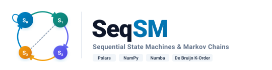

<p align="center">
  
</p>

# seqsm: Sequential State Machines & $K$-Order Markov Chains

`seqsm` is a domain-agnostic, high-performance Python library designed to learn, analyze, reduce, and simulate **$K$-order Markov Chains** and **Finite State Machines (FSMs)** from aligned multivariate discrete sequences. It features an intuitive Scikit-Learn-style estimator interface (`SeqSM`) with `fit`, `predict`, and `generate_schedule` methods.

---

## Key Highlights

- **Sparse Observed $K$-Window Indexing ($U_K$):** Avoids $|S|^K$ memory explosion by tracking only observed $K$-histories ($N_K \ll |S|^K$).
- **Dual Operator Formulation:**
  - **Rectangular Operator ($P^{(K)} \in \mathbb{R}^{N_K \times |S|}$):** Memory-efficient transition accumulation and immediate next-state querying.
  - **De Bruijn Square Companion Operator ($\tilde{P}^{(K)} \in \mathbb{R}^{N_K \times N_K}$):** Isomorphic first-order representation supporting OpenBLAS Level-3 matrix powers $(\tilde{P}^{(K)})^h$ for multi-step forecasting.
- **Clock & Semi-Markov Event Modes:**
  - `mode="clock"`: Uniform discrete time steps $\Delta t$, retaining self-transitions.
  - `mode="event"`: Semi-Markov run-length collapse of consecutive identical states into visits paired with empirical dwell-time distributions ($F_{\text{dwell}}$).
- **Valid-Arc Schedule Rollouts:** Graph pruning ($P_{uv} \ge \tau_{\text{prob}}$, $C_{uv} \ge \tau_{\text{count}}$) with fast Numba JIT simulation to produce synthetic schedules that strictly honor learned physical constraints.
- **Interpretable FSM Graphs & Visualization:** Direct string printing (`__str__` / `summary()`), native Matplotlib graph visualization (`fsm.plot()`), and exports to Mermaid flowcharts and Graphviz DOT digraphs with cycle extraction and edge difference summaries.
- **Generative Fidelity & Similarity:** Multi-aspect model comparison (`compare_similarity`) evaluating Jensen-Shannon divergence, stationary cosine similarity, directed edge Jaccard index, and transition concordance.

---

## Installation

`seqsm` requires Python `>= 3.12`.

```bash
pip install seqsm
```

### Core Dependencies
- `polars >= 2.1.0` (High-performance tabular data ingestion and expressions)
- `numpy >= 2.5.4` (OpenBLAS LEVEL-2 `dgemv` and LEVEL-3 `dgemm` vectorization)
- `numba >= 0.68.1` (JIT-compiled sliding-window kernels and simulation loops)

---

## Quickstart

### 1. Mining Household Routines & Generating Schedules

```python
from datetime import timedelta
import polars as pl
from seqsm import SeqSM

# 1. Load aligned discrete sensor time series
df = pl.DataFrame({
    "bedroom_motion": [0, 0, 1, 1, 0, 0, 1, 1],
    "living_light": ["off", "off", "dim", "on", "off", "off", "dim", "on"],
    "presence": ["home", "home", "home", "home", "away", "away", "home", "home"],
})

# 2. Fit K=2 SeqSM estimator in semi-Markov event mode
model = SeqSM(k=2, mode="event", smoothing=0.01)
model.fit(df)

# 3. Generate a 24-hour synthetic routine schedule
schedule_df = model.generate_schedule(
    window=timedelta(hours=24),
    time_unit="5m",
    method="sample",
)
print(schedule_df.head())
```


### 2. Exporting Interpretable State Machine Graphs

```python
# Extract pruned StateMachine graph
fsm = model.to_state_machine(min_prob=0.05, min_count=2)

# Export as Mermaid flowchart diagram
mermaid_code = fsm.to_mermaid(diff_labels=True)
print(mermaid_code)

# Extract dominant routine cycles
cycles = fsm.extract_cycles(max_length=6)
for c in cycles:
    print("Cycle:", c.state_sequence, "Persistence:", c.persistence)
```

### 3. Detecting Behavioral Anomalies

```python
# Compute negative log-likelihood on test streams
anomalies = model.score_anomalies(df, window_size=5, threshold_quantile=0.95)
print(anomalies.filter(pl.col("is_anomaly")))
```

---

## Development & Quality Gate

Development in `seqsm` follows the strict quality gates defined in `bp-python` and `bp-git`:

```bash
# Set up virtual environment and install test dependencies
python3 -m venv venv
venv/bin/pip install -q --upgrade . --group test

# Install pre-commit hooks
pre-commit install

# Run the complete test suite with coverage gate (>= 85%)
NUMBA_DISABLE_JIT=1 PYTHONPATH=src venv/bin/python -m coverage run --source=seqsm -m unittest discover -s test
venv/bin/python -m coverage report --fail-under=85

# Run linters and type-checkers
ruff check src test examples
ruff format --check src test examples
basedpyright
vulture
```

---

## License

MIT License. Copyright (c) 2026 Mário Antunes.
